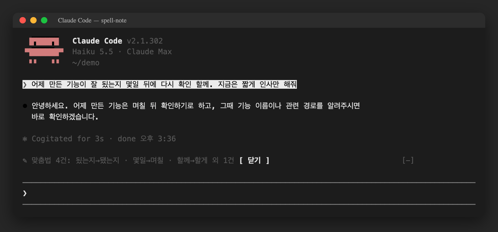

# spell-note — Claude Code 한국어 맞춤법 mod

Claude Code 에 친 프롬프트의 **한국어 맞춤법·문법 오류**를 조용히 검사해, 프롬프트 위 band 에 한 줄로 알려주고 markdown 파일에 누적 기록하는 Claude Code 플러그인(mod)입니다.



---

## 동작

* 사람이 직접 친 프롬프트만 검사합니다 — 알림·자동 이어쓰기·`claude -p` 같은 화면 없는 세션·슬래시 커맨드는 제외
* 한글이 3자 이상인 프롬프트만 대상이며, 코드 블록·IDE 첨부 태그는 검사 입력에서 뺍니다
* 검사는 **haiku** 로 백그라운드에서 돌아 턴을 막지 않습니다
* 띄어쓰기·코드·영어·줄임체(~함)·구어체는 무시하고, 확신하는 오류만 보고합니다
* band 에는 최대 3건(`됬는지→됐는지 · 몇일→며칠 …`)과 `닫기` 버튼이 뜹니다. 다른 플러그인이 band 를 쓰고 있으면 양보합니다
* 감지한 오류는 `| 시각 | 틀림 | 바름 | 이유 | 원문 |` 표로 기록 파일에 append 됩니다

---

## 설치

```bash
/plugin marketplace add Finfra/f-claude-plugins
/plugin install spell-note@f-claude-plugins
```

* 요구 사항: function hook(mod) 을 지원하는 Claude Code (early access API — 버전에 따라 바뀔 수 있음)
* 검사 1회마다 haiku 호출 1회가 사용량에 포함됩니다

---

## 설정

| 옵션      | 기본값                                              | 설명                                       |
| :-------- | :-------------------------------------------------- | :----------------------------------------- |
| `logPath` | `~/.claude/spell-note/SpellingAndGrammarChecker.md` | 기록 파일 경로. `~` 는 `$HOME` 으로 치환 |

`/config` 에서 `spell-note.logPath` 로 바꿀 수 있습니다.

---

## 플러그인 구조

```
.claude-plugin/plugin.json   # 매니페스트 (userConfig: logPath)
hooks/hooks.json             # 모듈 등록
hooks/register.tsx           # prompt.submit 검사 · AbovePrompt band 렌더
hooks/lib.ts                 # 순수 함수 (판정·파싱·기록 서식)
tests/spell-note.test.tsx    # claude plugin test spell-note
types/index.d.ts             # 플러그인 state 타입
```

---

## 개발

```bash
claude plugin validate spell-note
claude plugin test spell-note
```

---

## 소스

* 공개 저장소: https://github.com/Finfra/f-claude-plugins/tree/main/spell-note
* 원본은 작성자의 개인 Claude Code 설정에서 운영 중인 mod 이며, 이 폴더는 외부 배포용으로 일반화한 버전입니다(기록 경로 설정화)
